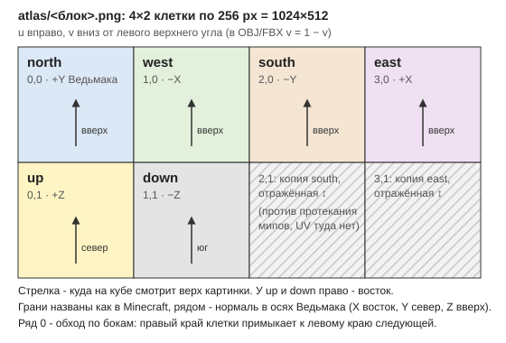

# tools: чтение файлов Witcher 3 5.0

Python 3.12, только stdlib (кроме `mc_textures.py`: Pillow, пин в `requirements.txt`). Все инструменты **только
читают** установку игры и REDkit и пишут туда, куда им сказали.
В папку игры не пишет ни один; извлечённые файлы (`w3bundle.py extract`, `bundle_extract.py`) не кладутся и в проект.
Исключение — `build_blocks.py`: он запускает `wcc_lite.exe`, а тот при каждом старте сам перезаписывает
`<REDkit>\r4data\x64.release.redscripts`.

| Файл | Что делает |
|---|---|
| `w3bundle.py` | `.bundle` (POTATO70): `list <папка\|файл> out.txt [full.tsv]` выдаёт список записей, `extract <bundle> <депо-путь> <out>` извлекает одну с проверкой CRC. Понимает раскладку 5.0 (version 5, запись 0x130, u64-смещения) и старую (0x140) |
| `bundle_extract.py` | извлекает из одного бандла все записи по подстроке депо-пути: `<bundle> <подстрока> <outdir>` |
| `cr2w.py` | инспектор CR2W (.w2ent, .w2mesh, .xbm; v156–164): имена, импорты, экспорты, ключевые свойства, вложенные CR2W. Класс `CR2WDoc` — запись (v155–164, побайтовый round-trip): пути импортов, свойства, вложенные CR2W, параметры материала, буферы |
| `build_blocks.py` | конвейер блоков через `wcc_lite` REDkit без GUI: шаблоны → `.w2mi`/`.w2mesh`/`.w2ent` → import → cook → кэши → бандлы → `metadata.store` → verify (раздел ниже, подробности — [REDKIT.md](../docs/REDKIT.md)) |
| `build_models.py` | модели из коробок Minecraft тем же конвейером, что блоки: тело Стива (20 частей по костям Геральта, скин 64x64 и второй слой) и лошадь (17 частей с седлом) -> мод `modMCWModels`. Меш — `box.w2mesh` с новыми позициями вершин, box-UV MC и без коллизии; геометрия и раскладка UV — `mc_models.json` (факты из исходников 1.21.11, без кода Mojang) |
| `mc_models.json` | модели MC 1.21.11 числами: части игрока и лошади, box-UV, оси, анимация ходьбы, пути текстур в клиентском jar |
| `collcache.py` | `content0\collision.cache` (CC3W v11): `list out.tsv` выдаёт все записи, `show <меш.w2mesh>` — physmat, число шейпов, полуразмеры box |
| `gen_templates.py` | пересобирает `spike\templates.json` (только метаданные: bbox, transform компонентов, physmat, бандлы): `python gen_templates.py ..\spike\templates.json`; после хотфикса игры — перезапустить и смотреть diff |
| `mc_textures.py` | текстуры блоков Minecraft 1.21.11 → атласы граней куба + `manifest.json` (раздел ниже) |
| `cube_mesh.py` | меш куба 1 м (OBJ + FBX ASCII) под раскладку атласа; в нём же раскладка, общая с `mc_textures.py` |

Бандлы лежат в `content\content0\bundles`. Пример:
`python w3bundle.py extract "<игра>\content\content0\bundles\xml.bundle" gameplay\globals\resources\gameplay.xml %TEMP%\x\gameplay.xml`

**Извлечённое — копии файлов CD PROJEKT RED.** Держать во временной папке, не класть в проект и в мод, не
распространять. В проект попадают только метаданные: пути, размеры, pivot (см. `spike/templates.json`).

## Текстуры блоков Minecraft: `mc_textures.py`, `cube_mesh.py`

Вход этапа 2 (REDkit): блок = сущность-куб 1 м со своим мешем и материалом на `pbr_std`. Всё, что не требует REDkit,
делают эти два скрипта. jar Minecraft только читается.

```
pip install -r requirements.txt          # Pillow 12.2.0
python mc_textures.py                    # MVP + серый куб -> %LOCALAPPDATA%\mcw\tex
python mc_textures.py --all --out %LOCALAPPDATA%\mcw\tex\all   # все blockstates, не-кубы пропускаются с причиной
python cube_mesh.py                      # меши -> %LOCALAPPDATA%\mcw\tex\mesh
python -m unittest test_mc_textures -v   # тесты на синтетическом мини-jar (+ проверки на настоящем jar, если он есть)
```

Параметры `mc_textures.py`: `--jar` (по умолчанию `%APPDATA%\.minecraft\versions\1.21.11\1.21.11.jar`),
`--blocks a,b,c`, `--all`, `--face-px 256` (клетка атласа, nearest-апскейл), `--gutter-px 0`, `--biome plains`,
`--climate T D`, `--normal` (плоская нормаль), `--masks` (альфа отдельным PNG), `--no-preview`.
**Выход — производные ассетов Mojang**, поэтому оба скрипта отказываются писать внутрь проекта, папки Ведьмака и
любой `.minecraft` (`cube_mesh.out_dir_problem`).

### Что делает конвертер
1. blockstate → вариант по умолчанию. В jar default state нет (он в коде блока), поэтому вариант выбирается по
   предпочтительным значениям свойств (`facing=north`, `axis=y`, `lit=false`, …; observer — `facing=south`). У
   вариантов-списков берётся первая модель (без случайного поворота). Multipart-блоки (заборы, стены, грибные блоки,
   резной книжный шкаф) пропускаются.
2. Модель: цепочка `parent`, ссылки `#name` (в том числе `#a → #b → текстура`), `elements` от ближайшей модели.
   Куб — это хотя бы один элемент 0..16 без поворота, покрывающий все 6 граней. Следующие полные элементы рисуются
   поверх (оверлей травы); внутренние элементы (ядро слизи, мёда, маяка, спавнера) отбрасываются с предупреждением;
   элемент, выходящий за 0..16 или повёрнутый, делает блок не-кубом.
3. Грань: `uv` (в 1/16, `u0 > u1` — отражение), `rotation` грани по часовой, первый кадр анимации (`frames[0]` из
   `.mcmeta`, размер кадра — `width`/`height` или квадрат по короткой стороне).
4. Тинт для граней с `tintindex`: трава и листва — точка `colormap/grass.png` / `foliage.png` по климату биома из
   `data/minecraft/worldgen/biome/<биом>.json` того же jar (plains: 0.8 / 0.4 → пиксель (50, 173) → трава `#91BD59`,
   листва `#77AB2F`); spruce `#619961`, birch `#80A755`, mangrove `#92C648`; вода — `water_color` биома (`#3F76E4`).
   Cherry, azalea, flowering azalea и pale oak не тонируются (как в игре). Источники — в docstring `mc_textures.py`.
   Тест сверяет постоянные цвета с `assets/minecraft/items/*.json` того же jar. Для биома `the_void` (им пользуется
   плоский мир сервера) получится трава `#8EB971` и листва `#71A74D`.
5. Поворот варианта `x`/`y` (бочка, наблюдатель, глазурованная терракота) переставляет и поворачивает грани; `uvlock`
   учитывается.
6. Альфа: `opaque` (все 255) → RGB PNG; `cutout` (только 0 и 255: листва, стекло, решётки) и `translucent`
   (цветное стекло, лёд, мёд, слизь, вода) → RGBA. Под прозрачными пикселями RGB заливается цветом соседей, чтобы
   мипы не тянули в край чёрное.

### Раскладка атласа и UV



```
+-------+-------+-------+-------+   1024x512 при --face-px 256 (степени двойки)
| north | west  | south | east  |   ряд 0: бока в порядке обхода, правый край клетки переходит в левый край следующей
+-------+-------+-------+-------+
|  up   | down  | (S)↕  | (E)↕  |   (S)↕, (E)↕ - отражённые копии south и east, на них UV не ссылается
+-------+-------+-------+-------+
```

- Картинка грани лежит так, как её видно снаружи блока в Minecraft: у боковых верх картинки — вверх, у `up` — на
  север, у `down` — на юг; у `up` и `down` право — восток. Для текстуры с uv на всю грань это сама PNG.
- Одна развёртка на все блоки: `mesh\mcw_cube_atlas.{obj,fbx}` — 24 вершины, 12 треугольников, метры, Z вверх, pivot
  в центре (как у `cont_crate`, `spike\templates.json`). Точка блока MC (0..1) → `(x − 0.5, 0.5 − z, y − 0.5)`;
  north → +Y Ведьмака, south → −Y, east → +X, west → −X, up → +Z, down → −Z. Поворот без отражения: на рендере
  по UV меша надпись на TNT читается, не зеркальна.
- UV в OBJ/FBX: V снизу вверх, `v = 1 − v_картинки`. Отступ `cube_mesh.py --inset-px 0.5` (в пикселях клетки) убирает билинейное
  смешивание с соседней клеткой на мипе 0. Клетки выровнены по 256, поэтому box-мипы граней не смешивают; если
  импортёр строит мипы широким фильтром, атлас собирается с `--gutter-px 8` (грань 240 px, рамка повтором края), а
  меш — `cube_mesh.py --gutter-px 8` с тем же числом.
- Блоки с шестью одинаковыми гранями (`"uniform": true`, у 1.21.11 таких 312 из 418) могут брать
  `face\<блок>.png` 256×256 и `mesh\mcw_cube_uniform.*` (каждая грань на всю текстуру).
- FBX — 7.4 ASCII, оси 3ds Max (Z вверх, правая тройка), `UnitScaleFactor` 100 (метры); `--fbx-units cm` пишет
  сантиметры. Blender ASCII-FBX не читает, для него — OBJ (импорт с Up = Z, Forward = Y).

### `manifest.json`
- верх: `jar`, `mc_version`, `biome` (климат, точка colormap, цвета), `params`, `layout` (клетки, размер),
  `normal_flat`, `summary` (сколько сконвертировано и пропущено, причины, альфа, время), `skipped` (блок → причина);
- `blocks.<id>`: `file` (атлас), `face_file` (для uniform), `mask_file`, `same_as` (одинаковый атлас уже записан под
  другим именем: `infested_stone` → `stone`, `waxed_*` → `*`), `alpha`, `uniform`, `unique_faces`, `same_faces`
  (группы одинаковых граней: у бревна `[up, down]` и 4 бока), `tint` (`rgb`, откуда, какие грани), `faces` (текстуры
  граней после поворота, оверлей через ` + `), `animated`, `variant`, `variants`, `rotation`, `model`, `parents`,
  `warnings`; `_unknown` — серый куб для неизвестных блоков (своя картинка, не Mojang).

### Прогон на 1.21.11 (2026-10-03)
- MVP (10 блоков + `_unknown`): все 10 сконвертированы, 0,1 с; cutout — `oak_leaves`, `glass`; тинт — `grass_block`
  (верх и оверлей боков), `oak_leaves`.
- `--all`: 1168 blockstates → 418 кубов (+ `_unknown`), 391 файл атласа (27 совпадают с другими), 2,7 с, 3,4 МБ.
  Пропущено 750: не куб 495, нет элементов 158 (сущности: сундуки, таблички, кровати, головы, баннеры, шалкеры; воздух,
  барьер, свет), multipart 96, нет боковых граней 1 (кактус). Альфа: opaque 373, cutout 24, translucent 22.
  Анимированных 13, с тинтом 9, с предупреждениями 8 (6 — отброшено внутреннее ядро, 2 — жидкость кубом).
- Превью-коллаж: `preview.png` рядом с манифестом (атлас с подписями клеток и три вида куба по UV меша).

### Что нужно треку REDkit
- Диффуз: `atlas\<блок>.png`, 1024×512, 8 бит, RGB для opaque и RGBA для cutout/translucent; для uniform-блоков —
  `face\<блок>.png` 256×256. Нормаль — `normal_flat.png` (128, 128, 255) того же размера или плоская по умолчанию
  у материала.
- Меш: `mesh\mcw_cube_atlas.fbx` (или OBJ через Blender и Witcher3-Blender-Tools), один материал `mcw_block`. Масштаб
  1 м и стороны после импорта **[проверить]** в REDkit: верх травы должен оказаться сверху, надпись TNT — читаемой.
- Альфа: листве и стеклу нужен alpha test, цветному стеклу, льду и воде — смешивание. Alpha test на `pbr_std` есть
  (вход Mask = альфа Diffuse, `enableMask` у материала, см. REDKIT.md «Альфа-тест»), смешивания на нём нет. Сжатие
  проверено: импорт кладёт opaque в DXT1 (WorldDiffuse), RGBA — в DXT5 (WorldDiffuseWithAlpha), альфа 0/255 доходит
  до мипа 0 без потерь.

## Модели из коробок: `build_models.py`

Собирает мод `modMCWModels`: тело Стива (20 частей: голова, торс, плечи, предплечья, бёдра, голени и второй слой
скина) и лошадь MC (17 частей с седлом). Части — сущности с одной коробкой: `box.w2mesh` с новыми позициями вершин,
box-UV Майнкрафта по текстуре 64x64 (увеличена до 1024 без сглаживания), без коллизии; материал — `pbr_std` с
альфа-тестом. Размеры и раскладка — `mc_models.json` (факты из исходников 1.21.11, кода Mojang в проекте нет), длины
частей тела — по костям Геральта. Рабочая папка — `%LOCALAPPDATA%\mcw\redkit_models`.

```
python build_models.py all --allow-wcc                        # скин assets_local\skins\geralt.png, лошадь chestnut, ~4 мин
python build_models.py all --allow-wcc --skin <png> --horse-coat white
python build_models.py prepare|verify                         # без wcc
python -m pytest -q test_build_models.py                      # box-UV, меш, части, сверка с mcw_models.ws
```

Мод — в `<work>\out\modMCWModels`; скопировать в `<игра>\mods\` и перезапустить игру (новые бандлы игра читает только
при старте). Части знает наизусть и `spike\mod\modMCW\…\mcw_models.ws` (пути, кости, пивоты лошади) — тест сверяет.

## Блоки через REDkit без GUI: `build_blocks.py`

Собирает мод `modMCWBlocks` (бандлы, `metadata.store`, `texture.cache`, `collision.cache`) из атласов
`mc_textures.py`. Всё производное от игры и REDkit лежит в `%LOCALAPPDATA%\mcw\redkit_work` (`<work>`), в проект не
попадает. Устанавливает мод в игру не он.

```
python build_blocks.py all --allow-wcc              # MVP из %LOCALAPPDATA%\mcw\tex\atlas -> <work>\out\modMCWBlocks
python build_blocks.py all --allow-wcc --test-png --work %LOCALAPPDATA%\mcw\redkit_work\test   # цветные грани с метками
python build_blocks.py prepare|verify [--blocks stone,dirt]                # без wcc
python build_blocks.py import|cook|caches|pack --allow-wcc [--compression ZLIB]
python build_blocks.py all --allow-wcc --out %LOCALAPPDATA%\mcw\redkit_work\out_alpha   # мод в другую папку, out\ не трогает
python build_blocks.py wcc --allow-wcc -- help import   # любой командлет wcc_lite в той же обвязке (--workspace: с депо мода)
python -m unittest test_cr2w_write test_build_blocks -v
```

| Шаг | Что делает | Время |
|---|---|---|
| prepare | `.w2mi`/`.w2mesh`/`.w2ent` из шаблонов `r4data` (`floor_brick.w2mi`, `engine\meshes\editor\box.w2mesh`, `box_05_05_1m.w2ent`) пишет в `<work>\project\workspace\mcw\blocks\` | < 1 с |
| import | `wcc_lite import -depot=local -file=<png> -out=<абсолютный путь>.xbm -texturegroup=WorldDiffuse` | ~15 с на блок |
| cook | `wcc_lite cook -platform=pc -mod=<workspace>\ -outdir=<work>\cooked\` | ~17 с |
| caches | `buildcache textures` и `buildcache physics` с `-db=cooked\cook.db` | 2 × 15 с |
| pack | `pack -compression=LZ4HC` (по умолчанию как у wcc) → `blob0.bundle` + `buffers0.bundle`; `metadatastore` | 2 × 14 с |
| verify | бандлы и crc (w3bundle), CR2W и все импорты, в том числе вложенные (cr2w), записи `texture.cache` (opaque — DXT1, cutout — DXT5), у cutout `enableMask` в w2mi и в материале меша, physmat и box 0,5 в `collision.cache` (collcache) | ~1 с |

Особенности wcc_lite, без которых конвейер не работает (подробно — в REDKIT.md):
- cwd = `<work>\wccroot\bin\x64_RedKit`. wcc берёт `..\gameconf.cfg` и кладёт `..\wcc.log` относительно cwd. В нашей
  копии `gameconf.cfg` поле `title` ведёт в `<work>\userdir`, иначе wcc пишет в `Documents\The Witcher 3`.
- Депо мода подключается ключами `-workspaceDir <work>\project\ -uncookDir <work>\uncook\`, именно через **пробел**.
  С `=` ключи молча игнорируются, и новые файлы ложатся в `<REDkit>\bin\`. Сами файлы мода лежат в `project\workspace\`.
- `import -depot=<путь>` падает («Remap is not supported for SplitEditorDepot!»). Поэтому используется `-depot=local`
  с абсолютным `-out`.
- Флаг `-agreetoterms` ставится всегда: без него открывается окно EULA.
- Без `--allow-wcc` скрипт wcc не запускает: wcc умеет писать в Documents, поэтому запускать его или нет, решает
  пользователь.
- После каждого вызова скрипт сверяет снимки Documents и верхних уровней REDkit и печатает WARNING, если там что-то
  изменилось. Для «Документов» сверяется верхний уровень и каждый файл `Documents\The Witcher 3`: размер, mtime и
  sha256.
